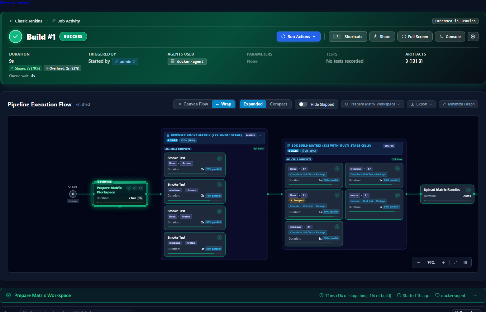
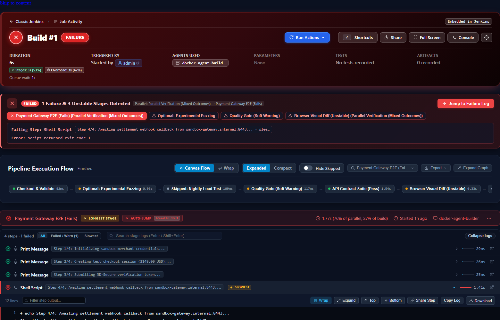
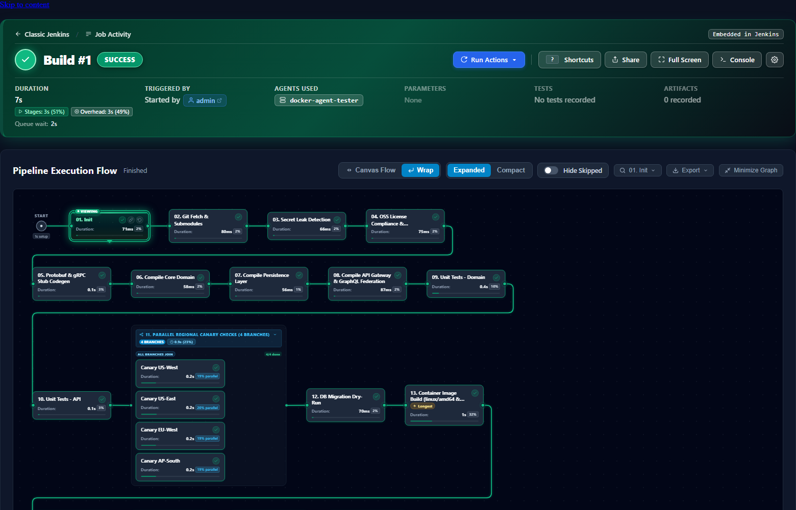
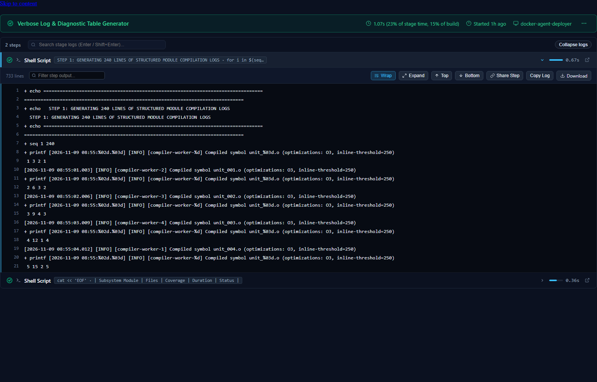

# Pipeline Horizon Jenkins Plugin

[](https://github.com/reder9/pipeline-horizon-jenkins-plugin/actions/workflows/ci.yml)
[](https://github.com/reder9/pipeline-horizon-jenkins-plugin/actions/workflows/release.yml)
[](https://plugins.jenkins.io/pipeline-horizon)
[](LICENSE)

**Pipeline Horizon** is a modern, high-performance pipeline DAG visualizer, live step log streamer, and build operations control center for Jenkins Pipelines. Built as the modern, enterprise-ready successor to Blue Ocean and the barebones Pipeline Graph View plugin, Horizon delivers zero-click failure triage, matrix and parallel multi-column layouts, deep step performance telemetry, and full build control without taking developers out of standard Jenkins.

---

## Visual Showcase

### 1. Declarative Matrix & Multi-Column Parallel Visualization
Effortlessly handles 2x2, 3x2, and 10+ branch parallel/matrix executions with clean axis badges (`[linux] · [chrome]`), multi-column responsive grids, and sub-stage flow indicators.



### 2. Zero-Click Failure Triage & "Minimize Graph" Breadcrumb Strip
When a build fails, Horizon immediately surfaces the failing step command, error exit code, and live terminal output with an inline **Auto-Jump** and **Reset to Start** control. The **Minimize Graph** mode collapses the 2D canvas into a compact horizontal breadcrumb bar to maximize terminal log height.



### 3. Serpentine Multi-Row Wrap Mode (Fits 20+ Stages on One Screen)
Say goodbye to infinite horizontal scrolling. Serpentine Wrap routes smooth SVG connectors across visual rows, displaying massive enterprise pipelines on a single desktop view.



### 4. Advanced Step Terminal & Live Output Inspector
ANSI 16/256/TrueColor support, per-step live filtering, line-range deep-linking (`#stage=...&step=...&L=10-25`), duration micro-bars, `Wrap` / `Expand` / `Top` / `Bottom` jump buttons, and full download capabilities.



---

## Why Pipeline Horizon? (Feature Comparison)

| Feature | Blue Ocean (Deprecated) | Pipeline Graph View | **Pipeline Horizon** |
| :--- | :---: | :---: | :---: |
| **Jenkins Integration** | Fullscreen SPA takeover (breaks breadcrumbs & sidebar) | Embedded | **Embedded with 1-click Fullscreen toggle & Minimized Strip** |
| **Declarative `matrix` Builds** | Flattens into giant vertical lists | Basic single-column list | **Dedicated `MATRIX` container, multi-column grid & axis badges** |
| **Skipped / `when` Conditions** | Greyed circle, no context | Greyed circle, no context | **Preserves topology with explicit skip-reason badge** |
| **Failure Triage** | Manual click-and-search | Manual stage/step expansion | **Instant Root-Cause Banner + Auto-Jump to leaf failure** |
| **Wide & Marathon Pipelines** | Infinite horizontal scrolling | Infinite horizontal scrolling | **Canvas Pan/Zoom, Serpentine Wrap & Minimized Strip** |
| **Step Console UX** | Basic log | Expandable log | **ANSI TrueColor, per-step search, Word-Wrap, Expand, Top/Bottom** |
| **Performance & Telemetry** | Raw duration only | Raw duration only | **Overhead vs. Stage Time, Queue Wait, `SLOWEST` badges, Micro-Bars** |
| **Multi-Agent / Pod Awareness** | Buried in console logs | Buried in console logs | **`AGENTS USED` header + Interactive Agent Breakdown Modal** |
| **Build Control Hub** | Basic abort | Basic rebuild | **Replay Modal with Groovy syntax linter, Restart Stage, Input approval** |
| **Controller Resource Impact** | Heavy React bundle & REST churn | Moderate | **Sub-millisecond LRU cache & background tab auto-throttling** |

---

## Quick Installation

### Option 1: Jenkins Update Center (Recommended once hosted)
1. Navigate to **Manage Jenkins** -> **Plugins** -> **Available plugins**.
2. Search for **Pipeline Horizon**.
3. Click **Install**.

### Option 2: Direct `.hpi` Deployment
Download the latest `pipeline-horizon.hpi` from [GitHub Releases](https://github.com/reder9/pipeline-horizon-jenkins-plugin/releases/latest) and upload via **Manage Jenkins** -> **Plugins** -> **Advanced settings** -> **Deploy Plugin**.

### Option 3: `jenkins-plugin-cli` / Dockerfile
```dockerfile
RUN jenkins-plugin-cli --plugins \
    workflow-aggregator \
    pipeline-graph-analysis \
    ionicons-api \
    https://github.com/reder9/pipeline-horizon-jenkins-plugin/releases/latest/download/pipeline-horizon.hpi
```

---

## Key Capabilities

### 1. Interactive Pipeline Execution Flow (`/job/{jobName}/{buildNumber}/horizon/`)
- **Three Layout Engines**:
  - **Canvas Flow**: Infinite pan & drag canvas with floating zoom controls (`-`, `100%`, `+`, `Fit`, `Grid`).
  - **Wrap Flow**: Serpentine multi-row layout wrapping stages smoothly below one another.
  - **Minimized Graph**: Collapses canvas into an interactive breadcrumb stage strip, dedicating 100% vertical viewport to step inspection.
- **Card Density Control**: Switch between **Expanded** (with durations, agent badges, and proportional execution bars) and **Compact** view.
- **Critical Path & Anomaly Detection**: Highlights the critical path bottleneck stage (`Longest Stage`) and tags individual slowest steps (`SLOWEST` badge).
- **Historical Variance**: Highlights execution time spikes (e.g. `SPIKE +48%` vs historical average) or faster completions (`-25% FASTER`).

### 2. Full Pipeline Operations Center
- **Interactive `input` Approval**: High-visibility approval banners and parameter modals allow operators to approve or abort paused pipelines directly inside the view.
- **Jenkinsfile Replay Editor**: Inspect or edit pipeline Groovy code with an integrated code editor featuring line numbers and live `/pipeline-model-converter/validate` syntax checking.
- **Restart from Stage**: Safely re-trigger failed or selected stages in Declarative Pipelines with 1 click.
- **Stop Build**: Instant CSRF-protected build cancellation for running runs.

### 3. Integrated Test Explorer & Artifact Archive
- **JUnit Test Explorer**: Filter test cases by `Failed`, `Skipped`, or `Passed`, search by class or test name, and inspect stack traces.
- **Archived Artifacts Browser**: Browse, search, and download build artifacts with human-readable file sizes.
- **SCM Commit Linking**: Displays commit messages, committers, and direct links to GitHub, GitLab, or Bitbucket.

---

## Security & Architecture

1. **Sub-Millisecond Completed Build Caching**:
   - Completed runs are immutable. Horizon maintains a thread-safe, bounded in-memory LRU cache (256 runs). Subsequent views return in **< 1ms** with zero FlowNode graph re-traversal or GC churn.
2. **Page Visibility Auto-Throttling**:
   - When a browser tab is hidden (`document.hidden`), Horizon automatically pauses background polling. Polling resumes immediately upon returning, preventing background controller flooding.
3. **Strict RBAC Enforcement**:
   - All REST APIs strictly enforce Jenkins permissions (`Item.READ`, `Item.BUILD`, `Item.CANCEL`). All mutations are guarded with `@RequirePOST` and valid CSRF crumbs.
4. **Tail-Safe Log Buffering**:
   - Step output streams buffer up to `512 KB` in memory with direct links to full raw logs, preventing browser memory exhaustion on multi-gigabyte builds.

---

## Building & Contributing

Requirements: **Java 21+** and **Maven 3.9+**.

```bash
# Run all unit tests, JenkinsRule integration tests, and SpotBugs
mvn clean verify

# Package plugin HPI
mvn clean package -DskipTests

# Run local interactive Jenkins development instance
mvn hpi:run
```

See [CONTRIBUTING.md](CONTRIBUTING.md) for pull request guidelines.

---

## License

Licensed under the [MIT License](LICENSE).
